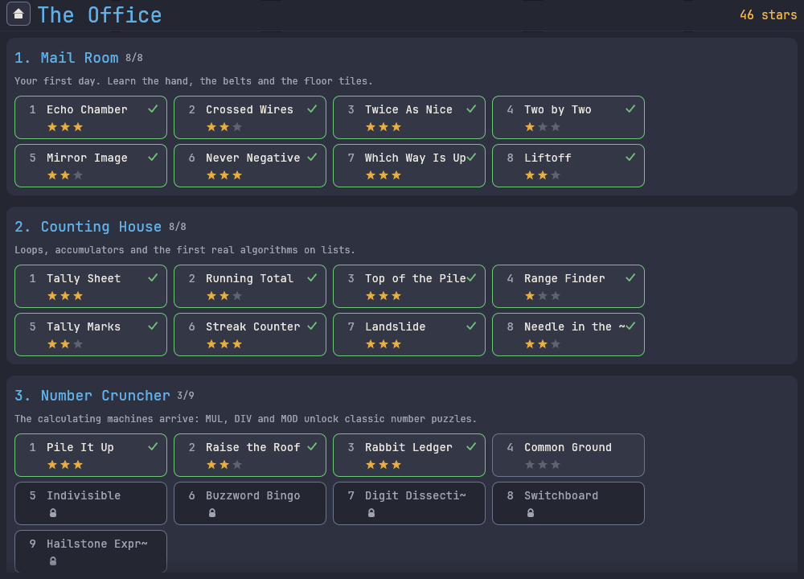
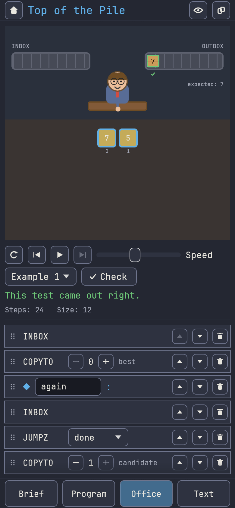
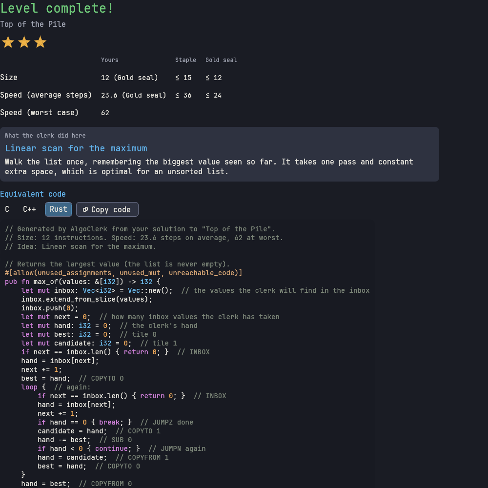
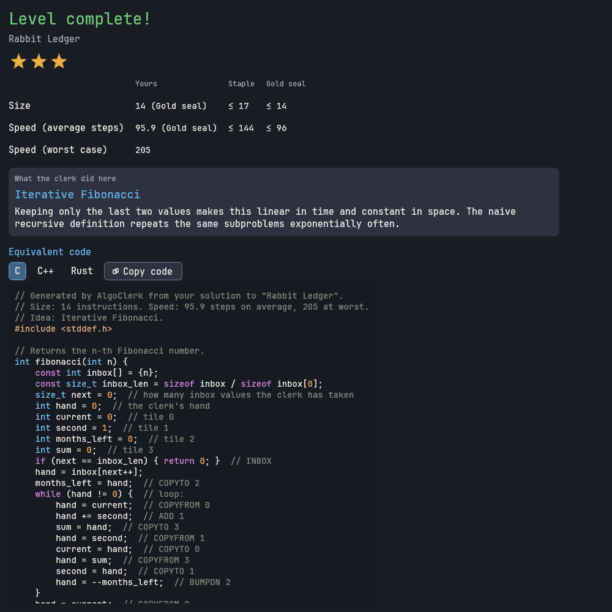

# AlgoClerk

[](https://github.com/algoclerk/algoclerk/actions/workflows/ci.yml)
[](LICENSE)
[](docs/BUILDING.md)
[](docs/BUILDING.md)

**An open source puzzle game for practising interview-style algorithm questions.**
You program a tiny office clerk with a handful of instructions. Each level is a classic algorithm
exercise, from "echo the inbox" to binary search, dynamic programming and linked lists. When you
beat a level, the game translates **your own program** into readable **C, C++ and Rust**.


*(Screenshots are rendered by the game's headless software renderer, see `scripts/screenshots.sh`.)*

## What makes it different

- **Equivalent-code reveal.** After solving a level you see your program as idiomatic C, C++ and Rust
  with syntax highlighting and a copy button, plus a note naming the standard algorithm you just
  wrote. The translation is a real decompiler (control flow is recovered into `while` / `if` where
  possible, and a correct `goto` or state-machine form is used otherwise) and it is **compiled and
  tested against the interpreter** on every level and on hundreds of random programs per test run.
  See [docs/CODEGEN.md](docs/CODEGEN.md).
- **48 levels in 7 wings** covering sums, max/min, prefix sums, majority vote, factorial, gcd,
  primes, FizzBuzz, bit tricks, stacks, queues, sorting (insertion, selection, bubble), binary
  search, two pointers, merge, Kadane, dynamic programming, linked lists and a prime sieve.
- **Levels are data.** One TOML file per level; add a puzzle with a pull request that never
  touches Rust. A validator and a test-suite check every level, including independent oracle
  solutions. See [docs/LEVEL_FORMAT.md](docs/LEVEL_FORMAT.md).
- **Graphical or textual, your choice.** Drag and drop instructions on desktop, tap on phones, or
  edit the same program as plain text in a side panel; the two stay in sync. Share solutions as text.
- **One game, five platforms.** macOS, Linux, Windows, Android and iOS from one Rust code base,
  touch friendly, with light / dark / high-contrast themes and a colour-blind friendly palette.
- **Own interpreter, no WebAssembly.** Player programs run in a small deterministic Rust
  interpreter (step limits, no I/O, no `unsafe`). There is no web build and no scripting engine.

| | |
| --- | --- |
|  |  |
|  |  |

## The clerk in 30 seconds

```text
-- Echo Chamber: pass every envelope through
again:
    INBOX              -- pick up the next envelope (the shift ends when the inbox is empty)
    OUTBOX             -- put it on the outbox
    JUMP again
```

Instructions: `INBOX OUTBOX COPYTO COPYFROM ADD SUB BUMPUP BUMPDN JUMP JUMPZ JUMPN`, later `MUL DIV MOD`
and pointer tiles `[n]` for arrays. Full reference: [docs/ISA.md](docs/ISA.md).
You are scored on **correctness** (hidden tests with edge cases), **size** (instructions) and
**speed** (steps), with staple and gold-seal targets per level.

## Quick start

Requirements: Rust 1.95 or newer (`rustup update`). Build output goes wherever `CARGO_TARGET_DIR`
points (default `target/`).

| Platform | Run it | Package it |
| --- | --- | --- |
| Linux | `cargo run --release -p algoclerk-app --bin algoclerk` | `linux/package-linux.sh` |
| macOS | `cargo run --release -p algoclerk-app --bin algoclerk` | `macos/package-macos.sh` |
| Windows | `cargo run --release -p algoclerk-app --bin algoclerk` | `windows/package-windows.ps1` |
| Android | install the APK from the release page | `android/build-android.sh release` |
| iOS | open the simulator build from the release page | `ios/build-ios.sh simulator` |

Per-platform requirements (Android SDK/NDK, Xcode, ...) and honest verification status are in
[docs/BUILDING.md](docs/BUILDING.md).

### Without a GUI

```sh
cargo run -p algoclerk-cli -- list
cargo run -p algoclerk-cli -- show max-of
cargo run -p algoclerk-cli -- judge --level max-of --solution my.asm        # add --json for machines
cargo run -p algoclerk-cli -- run --solution my.asm --input 3,-2,7,0 --trace
cargo run -p algoclerk-cli -- codegen --lang rust --level max-of --solution my.asm
cargo run -p algoclerk-cli -- judge --all --reference                        # the whole campaign
cargo run -p algoclerk-cli -- validate                                       # all shipped levels
```

## Add a level in 5 minutes

1. Copy a similar file: `cp levels/counting-house/max-of.toml levels/counting-house/my-level.toml`.
2. Change `id` (it must equal the file name), the texts, the tests and the `[solution]`.
3. `cargo run -p algoclerk-cli -- judge --level my-level --reference` until it passes, then
   `cargo run -p algoclerk-cli -- tune --level my-level` and paste the suggested `[targets]`.
4. `cargo run -p algoclerk-cli -- validate levels/counting-house` and `cargo test -p algoclerk-levels`.
5. Open a pull request. Details: [docs/LEVEL_FORMAT.md](docs/LEVEL_FORMAT.md) and
   [CONTRIBUTING.md](CONTRIBUTING.md).

## Project layout

```text
crates/algoclerk-core    ISA, assembler, VM, levels, judge, test generators, code generator (no GUI)
crates/algoclerk-levels  the shipped level packs, embedded into the binary
crates/algoclerk-cli     headless CLI: run, judge, validate, codegen, export
crates/algoclerk-app     the game (egui): desktop binary, Android cdylib, iOS static library
levels/                  puzzle data, one TOML file per level
docs/                    ISA, level format, architecture, code generation, building, ADRs
android/ ios/ macos/ windows/ linux/   packaging
```

See [docs/ARCHITECTURE.md](docs/ARCHITECTURE.md).

## Community

Contributions of all sizes are welcome: new levels, translations, themes, bug reports.
Start with [docs/GOOD_FIRST_ISSUES.md](docs/GOOD_FIRST_ISSUES.md), read the
[Code of Conduct](CODE_OF_CONDUCT.md) and [CONTRIBUTING.md](CONTRIBUTING.md). The plan is in
[ROADMAP.md](ROADMAP.md) (including a "level of the week" idea) and governance in
[GOVERNANCE.md](GOVERNANCE.md). There is no server and no leaderboard in v0.1: solutions are shared as text
([docs/SHARING.md](docs/SHARING.md)).

## Licence and credits

Apache License 2.0, see [LICENSE](LICENSE) and [NOTICE](NOTICE). All dependencies are permissively
licensed (`cargo deny check` runs in CI). The bundled font is JetBrains Mono (SIL OFL 1.1); art,
levels, texts and sounds were written for this project. See [CREDITS.md](CREDITS.md).

AlgoClerk is inspired by the genre of programming puzzle games (for example *Human Resource Machine*
by Tomorrow Corporation) and by classic algorithm interview topics. It contains no assets, text,
level designs or names from any of them, and it is not affiliated with or endorsed by them.

**WebAssembly policy:** AlgoClerk intentionally has no WebAssembly target, no browser build and no
WebAssembly runtime. Player programs are executed by AlgoClerk's own Rust interpreter.
