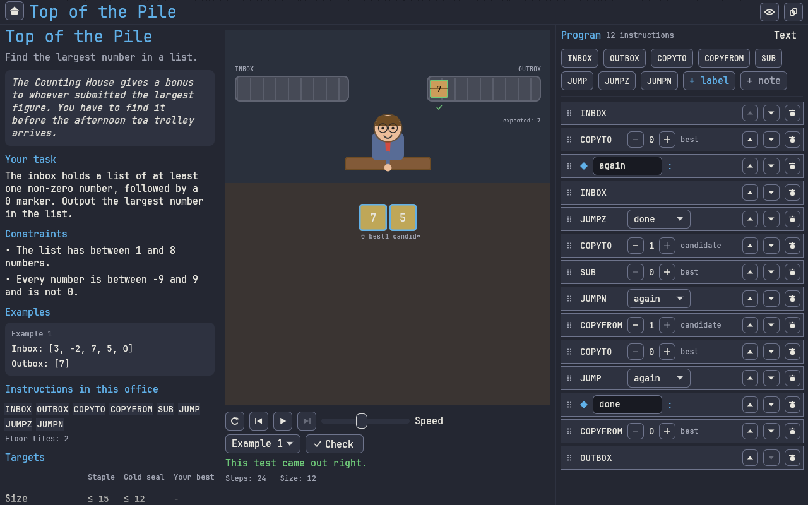
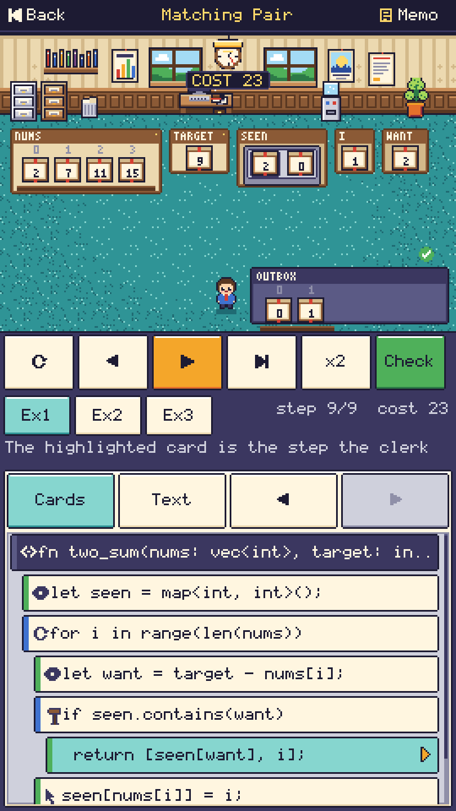
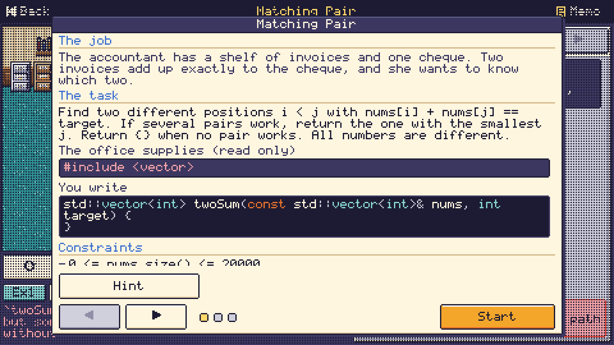
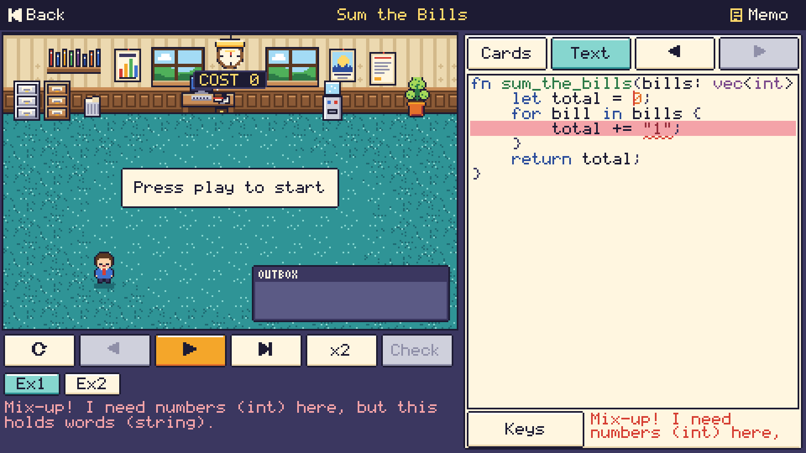
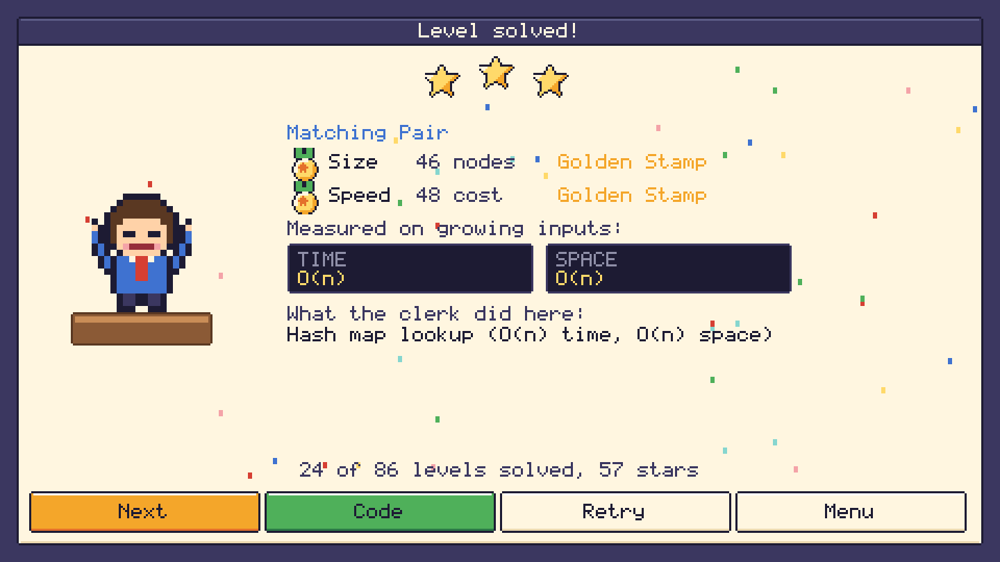

<h1 align="center">AlgoClerk</h1>

<p align="center">
  <a href="https://github.com/ericcurtin/algoclerk/actions/workflows/ci.yml"></a>
  <a href="LICENSE"></a>
  <a href="docs/BUILDING.md"></a>
  <a href="docs/BUILDING.md"></a>
</p>

<p align="center"><b>Write real C++ to solve office puzzles.</b><br>
A charming pixel-art game for practising interview-style algorithm questions. You write a real C++17 function
with <code>std::vector</code>, <code>std::unordered_map</code> and friends; the clerk acts it out in an office, and the game
tells you, politely, when your code would be undefined behaviour in a real compiler.</p>

<p align="center">
  
  
</p>

<p align="center">
  
  
  
</p>

## What it is

Each level is a real C++ function with a real signature, for example
`std::vector<int> twoSum(const std::vector<int>& nums, int target)`. The level shows a read-only prelude (the
`#include` lines and helper structs such as `ListNode`) and you write the function, plus helpers where the
level allows. Nothing is assembly-like and nothing is invented: what you type is what you would type in an
interview. The campaign has **86 levels in eleven wings** of the office building, from "sum a shelf" to hash
maps, sliding windows, stacks, heaps, binary search, BFS on grids and graphs, linked lists, trees and dynamic
programming, with a few boss floors. The last wing, **The Supply Cupboard**, is about C++ itself: passing by
reference or by value, the erase-remove idiom, a custom comparator, `std::priority_queue` with
`std::greater`, `std::string_view` against a copy, and the iterator `erase` idiom.

```cpp
#include <vector>
#include <unordered_map>

std::vector<int> twoSum(const std::vector<int>& nums, int target) {
    std::unordered_map<int, int> seen;
    for (int i = 0; i < static_cast<int>(nums.size()); ++i) {
        if (auto it = seen.find(target - nums[i]); it != seen.end()) {
            return {it->second, i};
        }
        seen[nums[i]] = i;
    }
    return {};
}
```

The game does not run a compiler. It has its own lexer, parser, type checker and interpreter for a carefully
defined subset of C++17, and the repository tests that interpreter against real `g++` and `clang++`. See
[docs/CPP_SUBSET.md](docs/CPP_SUBSET.md) for what is in the subset and
[docs/adr/0007-real-cpp-as-the-player-language.md](docs/adr/0007-real-cpp-as-the-player-language.md) for why.

## Features

- **Real C++17, with a safety net.** Every accepted program is valid C++17 that behaves the same with `g++` and
  `clang++`. Real C++ silently accepts bugs; the clerk does not: out-of-range indexing, signed overflow,
  division by zero, null and dangling pointers, uninitialised reads, iterator invalidation, missing returns and
  more are detected, highlighted on the line and explained in a speech bubble, and the judge rejects the
  program. The full list is in [docs/CPP_SUBSET.md](docs/CPP_SUBSET.md).
- **Visual-first.** Variables live in labelled trays and are drawn as what they are, with their C++ type in the
  header (`vector<int>`): ints as crates, strings as ribbons of letter tiles, vectors as shelves with indexed
  slots, grids as filing racks, maps as filing-cabinet drawers, sets as bins, stacks as spring plates, queues
  as belts, heaps as pyramids, linked lists as chains of tags, trees as org charts. The clerk walks to what
  changed; the wall clock ticks the abstract cost.
- **Cards and text, always in sync.** Edit the program as nested paper cards or as real C++ text with syntax
  colours, `std::` autocomplete filtered to what the level unlocks, error squiggles and an on-screen keyboard
  with C++ symbol rows. The text is the source of truth; what the cards cannot express yet is shown as a
  read-only "raw C++" card, and comments survive the round trip.
- **Interview-grade scoring.** Speed is an abstract cost that mirrors the real complexity of each STL operation
  (`unordered_map` lookups cost 1, `map` and `priority_queue` operations log n, `std::sort` n log n, copying a
  vector by value costs its length, so `const&` matters). Every level runs hidden **large** tests, and a
  brute-force O(n squared) answer runs out of time like a time-limit-exceeded verdict (53 of the 86 levels
  have such a naive solution). A solved level reports its
  measured time and space class plus medals for size and speed. See [docs/COST_MODEL.md](docs/COST_MODEL.md).
- **The thing a level is about is locked.** Each memo lists unlocked and locked headers and `std::` names, with a
  reason ("the supply cupboard on this floor does not stock `<numeric>`: adding things up is the exercise"), and
  a hint ladder of sticky notes.
- **Code reveal.** The victory screen opens on the C++ tab with your accepted solution as a clean formatted
  answer; the Rust and C tabs show the same program translated from the checked C++ tree. The translations are
  compile-tested with `rustc`, `gcc` and `clang` against the interpreter for every level reference and naive
  solution (one level, `drop-negatives`, a `std::list` erase loop, is deliberately not translated and shows a
  friendly message instead). The command line prints them too (`algoclerk-cli codegen LEVEL --lang rust`). See
  [docs/CODEGEN.md](docs/CODEGEN.md).
- **Levels are data.** One TOML file per level with a prelude, a real signature, seeded typed generators, a
  naive solution that must time out, and independent Rust oracles. See
  [docs/LEVEL_FORMAT.md](docs/LEVEL_FORMAT.md).
- **Five platforms, one Rust code base**: Linux, macOS, Windows, Android and iOS, touch, mouse and keyboard,
  with a warm retro-office palette, a colour-blind safe palette and a high-contrast theme, reduce-motion and
  text-size options, and original text-defined chiptune music.
- **Own interpreter, no WebAssembly, no compiler at run time.** Programs run in a deterministic, sandboxed Rust
  interpreter (cost, depth and memory limits, no I/O, no `unsafe`, fuzzed). There is no web build, no libclang
  and no scripting engine, so the game works on a phone with no toolchain.

## Quick start

Requirements: Rust 1.95 or newer (`rustup update`). On Linux the build needs a few system libraries for
Bevy (`libudev-dev`, `libwayland-dev`, `libxkbcommon-dev`, and `libasound2-dev` for sound); see
[docs/BUILDING.md](docs/BUILDING.md). To run the full test suite you also need `g++`, `clang++` and `rustc`
(see below).

```sh
cargo run --release -p algoclerk-app --bin algoclerk           # the game (add --features audio for sound)
cargo run -p algoclerk-cli -- list                             # all 86 levels
cargo run -p algoclerk-cli -- show two-sum                     # a brief
cargo run -p algoclerk-cli -- starter two-sum > my.cpp         # the starting program for a level
cargo run -p algoclerk-cli -- judge two-sum my.cpp             # judge your solution from the terminal
cargo run -p algoclerk-cli -- codegen two-sum --lang rust      # the reference as Rust (also c, cpp)
cargo run -p algoclerk-cli -- validate                         # prove every level is sound
cargo run -p algoclerk-cli -- diff two-sum                     # compile the level's solutions with g++ and clang++
scripts/screenshots.sh                                         # headless screenshots, no window or GPU
```

| Platform | Run it | Package it |
| --- | --- | --- |
| Linux | `cargo run --release -p algoclerk-app --bin algoclerk` | `linux/package-linux.sh --features audio` |
| macOS | same | `macos/package-macos.sh` |
| Windows | same | `windows/package-windows.ps1` |
| Android | install the APK from the release page | `android/build-android.sh release` |
| iOS | open the simulator build from the release page | `ios/build-ios.sh simulator` |

Per-platform requirements and an honest verification status are in [docs/BUILDING.md](docs/BUILDING.md): on
this branch the game was built and run on Linux (in a container, under Xvfb with a software Vulkan driver);
the other platform builds were not repeated, so treat them as unverified. There are real window captures in
`docs/screenshots/window-*.png`, and the remaining gaps are listed in [docs/PROGRESS.md](docs/PROGRESS.md).

### Tests

```sh
cargo test --workspace                          # everything; the compiler tests skip when a compiler is missing
ALGOCLERK_DIFF_CLANG=1 ALGOCLERK_PROP_CASES=500 \
  cargo test -p algoclerk-core --test cpp_prop_diff   # 500 random programs against g++ and clang++
```

The differential tests compile real C++ with `g++` and `clang++` and compare the result with the interpreter;
the translation tests also use `rustc`. Install all three for the full suite. Details and environment variables
are in [docs/BUILDING.md](docs/BUILDING.md).

## Add a level

1. Copy a neighbouring file in `levels/<wing>/` and change the texts, `prelude`, `signature`, `reference`,
   optional `naive`, examples, tests and generators.
2. `cargo run -p algoclerk-cli -- tune <id> --write` (medal targets), then
   `cargo run -p algoclerk-cli -- validate <id>` and `cargo run -p algoclerk-cli -- diff <id>` (real compilers).
3. Add the independent oracle to `crates/algoclerk-levels/tests/common/mod.rs` and open a pull request.
   Details: [docs/LEVEL_FORMAT.md](docs/LEVEL_FORMAT.md), [CONTRIBUTING.md](CONTRIBUTING.md).

## Project layout

```text
crates/algoclerk-core    C++ front end and interpreter, judge, complexity estimator, level model, validator, code generators
crates/algoclerk-levels  the 86 shipped levels, embedded into the binary
crates/algoclerk-media   pixel-art engine: palettes, .px sprites, fonts, software canvas, chiptune synth
crates/algoclerk-game    the game itself (engine-free: Game::tick / Game::draw), headless scenarios
crates/algoclerk-app     thin Bevy shell: desktop binary, Android cdylib, iOS static library
crates/algoclerk-cli     headless CLI        crates/algoclerk-tools   screenshot tool
levels/  assets/art  assets/music  docs/  android/ ios/ macos/ windows/ linux/
```

See [docs/ARCHITECTURE.md](docs/ARCHITECTURE.md) and [docs/ART_PIPELINE.md](docs/ART_PIPELINE.md).

## Community

New levels, art, music, translations and palettes are welcome, and so are fixes for gaps in the C++ subset.
Start with [docs/GOOD_FIRST_ISSUES.md](docs/GOOD_FIRST_ISSUES.md), read the
[Code of Conduct](CODE_OF_CONDUCT.md) and [CONTRIBUTING.md](CONTRIBUTING.md). The plan is in
[ROADMAP.md](ROADMAP.md), governance in [GOVERNANCE.md](GOVERNANCE.md). There is no server and no leaderboard.

## Licence and credits

Apache License 2.0, see [LICENSE](LICENSE) and [NOTICE](NOTICE). All dependencies are permissively licensed
(`cargo deny check licenses bans` runs in CI). The pixel-art engine design and the app shell structure are
adapted from the sibling project Falabichos; every sprite, glyph, palette, song, level and text of AlgoClerk is
new. See [CREDITS.md](CREDITS.md).

AlgoClerk is inspired by the genre of programming puzzle games and by classic algorithm interview topics. It
contains no assets, text, level designs or names from any of them and is not affiliated with or endorsed by them.

**WebAssembly policy:** AlgoClerk intentionally has no WebAssembly target, no browser build and no WebAssembly
runtime. Player programs are executed by AlgoClerk's own Rust interpreter.
