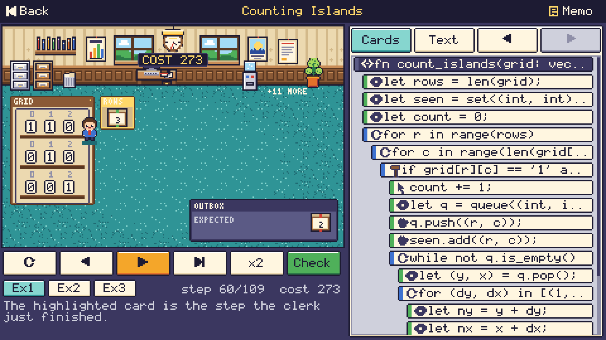
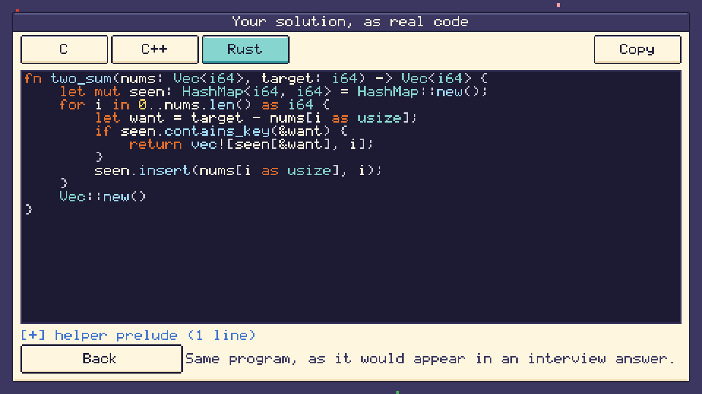
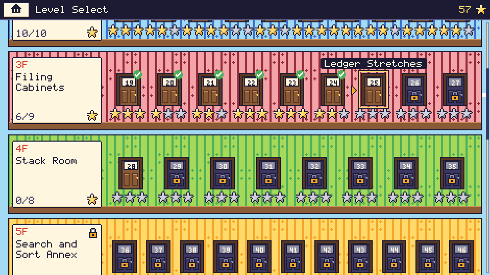

<h1 align="center">AlgoClerk</h1>

<p align="center">
  <a href="https://github.com/ericcurtin/algoclerk/actions/workflows/ci.yml"></a>
  <a href="LICENSE"></a>
  <a href="docs/BUILDING.md"></a>
  <a href="docs/BUILDING.md"></a>
</p>

<p align="center"><b>A charming pixel-art puzzle game for practising interview-style algorithm questions.</b><br>
You write the solution in a small, typed, high-level language with strings, vectors, maps and more;
the clerk acts it out in an office, and when you win the game shows your program as real C, C++ and Rust.</p>

<p align="center">
  
  
</p>

<p align="center">
  
  
  
</p>

## What it is

Each level is a function with a typed signature, for example
`fn two_sum(nums: vec<int>, target: int) -> vec<int>`, and you write the body in **ClerkScript** with the same
ideas as a real interview answer. Nothing is assembly-like. The campaign has **80 levels in ten wings** of the
office building, from "sum a shelf" to hash maps, sliding windows, stacks, heaps, binary search, BFS on grids
and graphs, linked lists, trees and dynamic programming, with a few boss floors.

```text
fn two_sum(nums: vec<int>, target: int) -> vec<int> {
    let seen = map<int, int>();
    for i in range(len(nums)) {
        let want = target - nums[i];
        if seen.contains(want) {
            return [seen[want], i];
        }
        seen[nums[i]] = i;
    }
    return [];
}
```

## Features

- **Visual-first.** Variables live in labelled trays and are drawn as what they are: ints as crates, strings as
  ribbons of letter tiles, vectors as shelves with indexed slots, grids as filing racks, maps as filing-cabinet
  drawers, sets as bins, stacks as spring plates, queues as belts, heaps as pyramids, linked lists as chains of
  tags, trees as org charts. The clerk walks to what changed; the wall clock ticks the abstract cost.
- **Cards and text, always in sync.** Edit the program as nested paper cards (a chip pad of variables, numbers,
  operators and the unlocked tools filtered by type; drag to reorder; undo and redo) or as text (auto-indent,
  error squiggles, on-screen keyboard). No typing is needed to finish the game on a phone.
- **Interview-grade scoring.** Speed is an abstract cost that mirrors real complexity, and every level runs
  hidden **large** tests: a brute-force O(n squared) answer runs out of time exactly like a time-limit-exceeded
  verdict. A solved level reports its measured time and space class, plus medals for size and speed.
- **The thing a level is about is locked.** Each memo lists unlocked and locked tools (no `sorted` in the
  "sort it yourself" level, no `sum` in the accumulator level) and a hint ladder of sticky notes.
- **Real code reveal.** Your solution as idiomatic C++ (`std::vector`, `std::unordered_map`, range-for), Rust
  (`Vec`, `HashMap`, iterators) and C (a small readable helper prelude), compiled with gcc, g++, clang and
  rustc and compared against the interpreter on every level and on random programs. See
  [docs/CODEGEN.md](docs/CODEGEN.md).
- **Levels are data.** One TOML file per level with seeded typed generators, a naive solution that must time
  out, and independent Rust oracles. See [docs/LEVEL_FORMAT.md](docs/LEVEL_FORMAT.md).
- **Five platforms, one Rust code base**: Linux, macOS, Windows, Android and iOS, touch, mouse and keyboard,
  with a warm retro-office palette, a colour-blind safe palette and a high-contrast theme, reduce-motion and
  text-size options, and original text-defined chiptune music.
- **Own interpreter, no WebAssembly.** Programs run in a deterministic, sandboxed Rust interpreter (step,
  depth and memory limits, no I/O, no `unsafe`, fuzzed). There is no web build and no scripting engine.

## The language in 30 seconds

Types `int bool char string vec<T> set<T> map<K,V> (A,B) option<T> stack<T> queue<T> deque<T> heap<T> lnode
tnode`; statements `let if else while for break continue return`; helpers, `&mut` parameters and recursion
where a level unlocks them. Reference, grammar and the cost model: [docs/LANGUAGE.md](docs/LANGUAGE.md).

## Quick start

Requirements: Rust 1.95 or newer (`rustup update`). On Linux the build needs a few system libraries for
Bevy (`libudev-dev`, `libwayland-dev`, `libxkbcommon-dev`, and `libasound2-dev` for sound); see
[docs/BUILDING.md](docs/BUILDING.md).

```sh
cargo run --release -p algoclerk-app --bin algoclerk           # the game (add --features audio for sound)
cargo run -p algoclerk-cli -- list                             # all 80 levels
cargo run -p algoclerk-cli -- show two-sum                     # a brief
cargo run -p algoclerk-cli -- judge two-sum my.ck              # judge a solution from the terminal
cargo run -p algoclerk-cli -- codegen two-sum --lang cpp       # the reference as C++ (also c, rust)
cargo run -p algoclerk-cli -- validate                         # prove every level is sound
scripts/screenshots.sh                                         # headless screenshots, no window or GPU
```

| Platform | Run it | Package it |
| --- | --- | --- |
| Linux | `cargo run --release -p algoclerk-app --bin algoclerk` | `linux/package-linux.sh --features audio` |
| macOS | same | `macos/package-macos.sh` |
| Windows | same | `windows/package-windows.ps1` |
| Android | install the APK from the release page | `android/build-android.sh release` |
| iOS | open the simulator build from the release page | `ios/build-ios.sh simulator` |

Per-platform requirements and an honest verification status are in [docs/BUILDING.md](docs/BUILDING.md).

## Add a level

1. Copy a neighbouring file in `levels/<wing>/` and change the texts, `signature`, `reference`, optional
   `naive`, examples, tests and generators.
2. `cargo run -p algoclerk-cli -- tune <id> --write` (medal targets), then `cargo run -p algoclerk-cli -- validate <id>`.
3. Add the independent oracle to `crates/algoclerk-levels/tests/oracles.rs` and open a pull request.
   Details: [docs/LEVEL_FORMAT.md](docs/LEVEL_FORMAT.md), [CONTRIBUTING.md](CONTRIBUTING.md).

## Project layout

```text
crates/algoclerk-core    ClerkScript, judge, complexity estimator, level model, validator, code generators
crates/algoclerk-levels  the 80 shipped levels, embedded into the binary
crates/algoclerk-media   pixel-art engine: palettes, .px sprites, fonts, software canvas, chiptune synth
crates/algoclerk-game    the game itself (engine-free: Game::tick / Game::draw), headless scenarios
crates/algoclerk-app     thin Bevy shell: desktop binary, Android cdylib, iOS static library
crates/algoclerk-cli     headless CLI        crates/algoclerk-tools   screenshot tool
levels/  assets/art  assets/music  docs/  android/ ios/ macos/ windows/ linux/
```

See [docs/ARCHITECTURE.md](docs/ARCHITECTURE.md) and [docs/ART_PIPELINE.md](docs/ART_PIPELINE.md).

## Community

New levels, art, music, translations and palettes are welcome. Start with
[docs/GOOD_FIRST_ISSUES.md](docs/GOOD_FIRST_ISSUES.md), read the [Code of Conduct](CODE_OF_CONDUCT.md) and
[CONTRIBUTING.md](CONTRIBUTING.md). The plan is in [ROADMAP.md](ROADMAP.md), governance in
[GOVERNANCE.md](GOVERNANCE.md). There is no server and no leaderboard.

## Licence and credits

Apache License 2.0, see [LICENSE](LICENSE) and [NOTICE](NOTICE). All dependencies are permissively licensed
(`cargo deny check licenses bans` runs in CI). The pixel-art engine design and the app shell structure are
adapted from the sibling project Falabichos; every sprite, glyph, palette, song, level and text of AlgoClerk is
new. See [CREDITS.md](CREDITS.md).

AlgoClerk is inspired by the genre of programming puzzle games and by classic algorithm interview topics. It
contains no assets, text, level designs or names from any of them and is not affiliated with or endorsed by them.

**WebAssembly policy:** AlgoClerk intentionally has no WebAssembly target, no browser build and no WebAssembly
runtime. Player programs are executed by AlgoClerk's own Rust interpreter.
